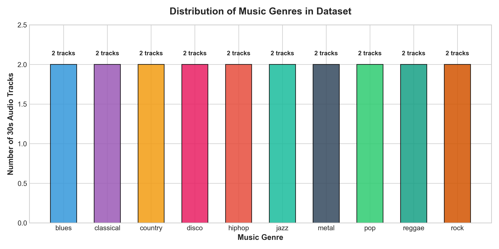
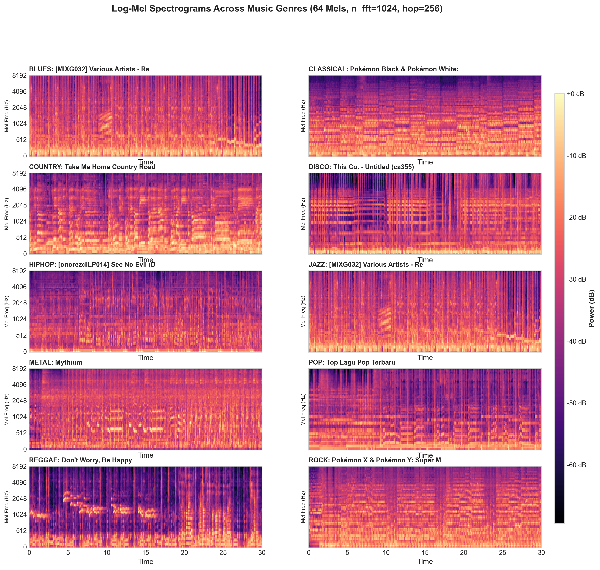
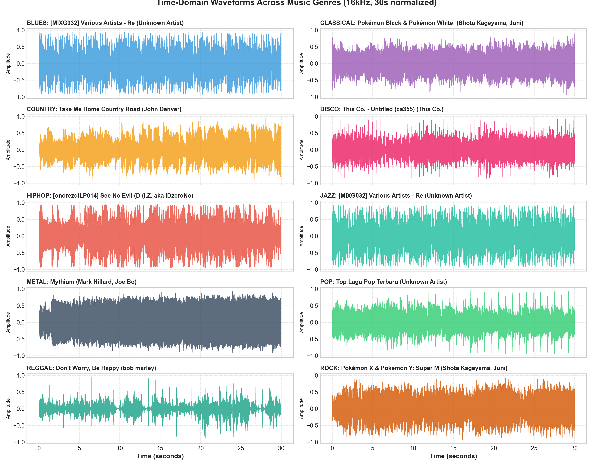
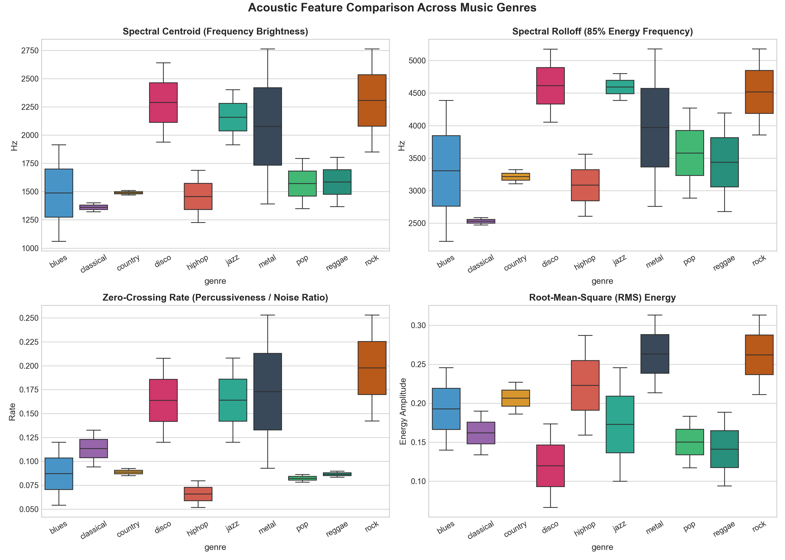

# 🎵 Music Genre Audio Crawler & Kaggle Dataset Toolkit

[](https://www.python.org/)
[](LICENSE)
[](https://librosa.org/)
[](https://www.kaggle.com/)

A modular, automated toolkit to **crawl, standardize, analyze, and publish open-access music audio datasets** for Deep Learning, Audio Classification, and Music Information Retrieval (MIR).

---

## 🌟 Key Features

1. **Automated Multi-Genre Crawler (`music_crawler.py`)**:
   - Downloads royalty-free / open-access music tracks from Internet Archive (The Great 78 Project, Netlabels, Creative Commons collections).
   - Covers **10 standard musical genres**: `blues`, `classical`, `country`, `disco`, `hiphop`, `jazz`, `metal`, `pop`, `reggae`, `rock`.
   - Built-in deduplication, retry logic, and resume capability.

2. **Standardized Audio Preprocessing Pipeline**:
   - **Duration**: Standardized to exactly **30.0 seconds** (configurable, skips initial silence).
   - **Sample Rate**: **16,000 Hz** (Optimal for Audio Transformers like DINOv3, AST, and Spectrogram CNNs).
   - **Channels**: **Mono** (1 channel, 16-bit PCM Linear).
   - **Peak Normalization**: Scaled to $[-0.95, +0.95]$ to ensure consistent loudness.

3. **Complete Provenance & Metadata (`metadata.csv`)**:
   - Each track includes: `track_id`, `filename`, `genre`, `title`, `artist`, `duration_seconds`, `sample_rate`, `license`, and `source_url`.

4. **Exploratory Data Analysis & Signal Visualizer (`visualize_dataset.py`)**:
   - Generates high-resolution publication charts:
     - Class distribution and track counts.
     - Time-domain waveform comparisons.
     - 64-Mel Log-Mel Spectrogram heatmaps.
     - Acoustic feature distributions (Spectral Centroid, Spectral Rolloff, Zero-Crossing Rate, RMS Energy).

5. **Kaggle Integration**:
   - Includes `dataset-metadata.json` for 1-command upload via Kaggle CLI.
   - Includes `Music_Genre_EDA_and_Visualization.ipynb` ready to import as a Kaggle Notebook.

---

## 📁 Repository Structure

```
music-genre-crawler/
├── music_crawler.py                        # Core crawler & audio standardization pipeline
├── visualize_dataset.py                    # Audio signal analysis & chart generator
├── Music_Genre_EDA_and_Visualization.ipynb # Interactive Kaggle Notebook
├── metadata.csv                            # Sample metadata for crawled tracks
├── dataset-metadata.json                   # Kaggle dataset definition
├── figures/                                # Pre-generated EDA figures
│   ├── 01_class_distribution.png
│   ├── 02_waveforms_comparison.png
│   ├── 03_spectrograms_comparison.png
│   └── 04_acoustic_features_comparison.png
├── requirements.txt                        # Python dependencies
├── .gitignore
├── LICENSE                                 # MIT License
└── README.md
```

---

## 🚀 Quick Start

### 1. Installation
Clone the repository and install required packages:
```bash
git clone https://github.com/YOUR_USERNAME/music-genre-crawler.git
cd music-genre-crawler

pip install -r requirements.txt
```

### 2. Crawl Music Data
Crawl 5 tracks per genre (50 tracks total):
```bash
python music_crawler.py --tracks_per_genre 5 --output_dir .
```
- Custom number of tracks: `--tracks_per_genre 20` (200 tracks total).
- The audio files will be saved in `audio/<genre>/<genre_id>.wav` and logged into `metadata.csv`.

### 3. Generate Visualizations & Audio Analysis
Run the visualization script to generate publication-grade figures in `figures/`:
```bash
python visualize_dataset.py
```

### 4. Upload to Kaggle
#### Option A: Using Kaggle CLI
1. Configure your Kaggle API key (`kaggle.json`).
2. Update `"id": "YOUR_KAGGLE_USERNAME/music-genre-recognition-10-genres"` in `dataset-metadata.json`.
3. Push dataset to Kaggle:
   ```bash
   kaggle datasets create -p .
   ```

#### Option B: Via Kaggle Web UI
1. Go to [kaggle.com/datasets](https://www.kaggle.com/datasets) $\to$ **New Dataset**.
2. Upload the `audio/` folder, `metadata.csv`, and `README.md`.
3. Create your public or private dataset!

---

## 📊 Previews of Generated Visualizations

| Class Distribution | Log-Mel Spectrograms |
| :---: | :---: |
|  |  |

| Waveforms Comparison | Acoustic Features (Centroid, Rolloff, ZCR) |
| :---: | :---: |
|  |  |

---

## 📜 Legal Provenance & Licensing

All audio tracks gathered through this tool are retrieved from public collections (Internet Archive, Open Netlabels, The Great 78 Project) and distributed under **Creative Commons** or **Public Domain** licenses for research, educational, and Machine Learning benchmarking purposes.

Software code is released under the **MIT License**.
